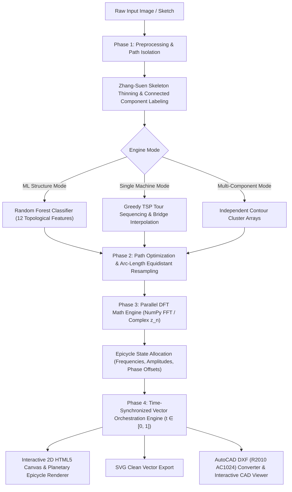
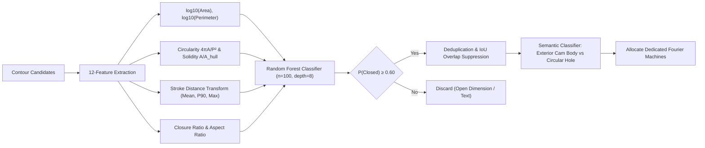

# Architectural & Mathematical Specification: Planetary Fourier Epicycle Machine

## 1. Executive Summary & System Overview

This system transforms arbitrary raster engineering sketches, architectural floor plans, and mechanical diagrams into time-synchronized **planetary epicycle machines** governed by the **Discrete Fourier Transform (DFT)**.

The architecture consists of four tightly-coupled execution phases, augmented by a **topological Machine Learning structure separator** and an **AutoCAD DXF CAD conversion engine**:



---

## 2. Phase 1: Preprocessing & Path Isolation

**Source File**: [`fourier_engine.py`](file:///home/udhayan/fourier/fourier_engine.py#L98-L182)

The preprocessing phase converts dense 2D pixel grids into discrete, ordered 1-pixel skeleton tracks while eliminating raster artifacts.

### 2.1 Binarization & Adaptive Inversion
- **Input**: BGR or single-channel grayscale image $I(x, y) \in [0, 255]$.
- **Thresholding**: Evaluated via Otsu's optimal clustering criterion minimizing intra-class variance:
  $$\sigma_w^2(t) = \omega_0(t)\sigma_0^2(t) + \omega_1(t)\sigma_1^2(t)$$
- **Foreground Inversion**: In engineering sketches, ink strokes are dark ($0$) on light paper ($255$). The pipeline bitwise-inverts the image so foreground strokes evaluate to white ($255$) and background to black ($0$).

### 2.2 Zhang-Suen Morphological Skeleton Thinning
Lines in sketches often have varying physical widths ($2$ to $10$ pixels). Passing wide strokes directly to contour extraction generates dual parallel boundary tracks. The **Zhang-Suen thinning algorithm** iteratively erodes boundary pixels without disrupting topological connectivity:

For each foreground pixel $P_1$ with an 8-neighborhood ordered $(P_2, P_3, \dots, P_9, P_2)$:
1. **Condition Set 1 (Sub-iteration 1)**:
   $$2 \le B(P_1) \le 6, \quad A(P_1) = 1, \quad P_2 \cdot P_4 \cdot P_6 = 0, \quad P_4 \cdot P_6 \cdot P_8 = 0$$
2. **Condition Set 2 (Sub-iteration 2)**:
   $$2 \le B(P_1) \le 6, \quad A(P_1) = 1, \quad P_2 \cdot P_4 \cdot P_8 = 0, \quad P_2 \cdot P_6 \cdot P_8 = 0$$
Where:
- $B(P_1) = \sum_{k=2}^9 P_k$ is the non-zero neighbor count.
- $A(P_1)$ is the number of $0 \to 1$ transitions in the circular sequence $P_2, P_3, \dots, P_9, P_2$.

This reduces all strokes down to a **strict 1-pixel centerline skeleton**.

### 2.3 Connected Component Labeling (CCL)
Using 8-way connectivity, the image is segmented into distinct equivalence classes:
$$\mathcal{L}(x, y) \in \{1, 2, \dots, K\}$$
- Clusters with an area below `min_component_area` (default: $15\text{ px}$) are discarded as noise.
- Distinct clusters (such as isolated text labels like `"BATH"` versus structural load-bearing walls) are isolated into individual binary masks.

### 2.4 Boundary Contour Extraction
Each mask is processed using Suzuki's topological border following algorithm (`cv2.findContours` with `RETR_EXTERNAL` or `RETR_TREE`), outputting sequential coordinate tracks:
$$\text{Paths} = [P_1, P_2, \dots, P_N], \quad P_k = [(x_0, y_0), (x_1, y_1), \dots, (x_{M-1}, y_{M-1})]$$

---

## 3. Phase 2: Path Optimization & Ordering

**Source File**: [`fourier_engine.py`](file:///home/udhayan/fourier/fourier_engine.py#L184-L306)

The Discrete Fourier Transform requires an ordered parameterization with uniform time intervals $\Delta t$. Randomly unordered points create severe high-frequency ringing (Gibbs phenomenon).

### 3.1 Open-Path Doubling (Synthetic Periodic Loops)
Natural line drawings contain open lines (e.g., straight centerlines, dimension lines, letters like "T" or "L"). An open trajectory cannot form a periodic signal without jumping across the canvas at $t = 1 \to 0$.

- If $\|P_0 - P_{M-1}\|_2 > \tau_{\text{closure}}$ (default: $3.5\text{ px}$), the path is open.
- The path is reflected in reverse without duplicating endpoints:
  $$[A, B, C, D] \longrightarrow [A, B, C, D, C, B, A]$$
- This creates a smooth, closed synthetic manifold that the Fourier epicycle tip traverses forward and backward with continuity.

### 3.2 Arc-Length Uniform Resampling
Manual drawing strokes vary in pixel density based on stylus velocity or line curvature. Phase 2 parameterizes the curve by cumulative arc length:
$$s_0 = 0, \quad s_k = s_{k-1} + \|P_k - P_{k-1}\|_2, \quad S = s_{M-1}$$
The total path length $S$ is divided into $N$ equal segments:
$$u_m = m \cdot \frac{S}{N}, \quad m \in \{0, 1, \dots, N-1\}$$
Coordinates $(x_m, y_m)$ are interpolated via piece-wise linear interpolation:
$$x(u_m) = \text{Interp}(u_m, \{s_k\}, \{x_k\}), \quad y(u_m) = \text{Interp}(u_m, \{s_k\}, \{y_k\})$$
This guarantees a constant velocity $|\dot{\mathbf{r}}(t)| = \text{const}$ and a standardized time step $\Delta t = 1/N$.

### 3.3 Tour Sequencing (Single Fourier Machine Mode)
When running in **Single Machine Mode**, all disjoint contours are unified into one closed tour using greedy nearest-neighbor sequencing with 4-point linear transition bridges:
$$\text{Bridge}(P_{\text{exit}}, P_{\text{entry}}) = \text{Linspace}(P_{\text{exit}}, P_{\text{entry}}, 4)$$
This allows a single unbroken epicycle chain to synthesize complex multi-component diagrams.

---

## 4. Phase 3: Parallel DFT Computation (The Math Engine)

**Source File**: [`fourier_engine.py`](file:///home/udhayan/fourier/fourier_engine.py#L308-L414)

### 4.1 Complex Representation & Mathematical Foundation
Each 2D point $(x_n, y_n)$ in a path of length $N$ is mapped to a complex number on the Argand plane:
$$z_n = x_n + i y_n, \quad n \in \{0, 1, \dots, N-1\}$$

The Discrete Fourier Transform decomposes $z_n$ into a sum of rotating complex exponentials:
$$c_k = \frac{1}{N} \sum_{n=0}^{N-1} z_n \cdot e^{-i \frac{2\pi k n}{N}}, \quad k \in \left\{ -\frac{N}{2}, \dots, \frac{N}{2} - 1 \right\}$$

### 4.2 Parameter Extraction for Planetary Epicycles
By Euler's formula $e^{i\theta} = \cos\theta + i\sin\theta$, each complex coefficient $c_k = \text{Re}(c_k) + i\text{Im}(c_k)$ yields three parameters:

| Parameter | Mathematical Formulation | Physical Interpretation in Fourier Machine |
| :--- | :--- | :--- |
| **Frequency ($f_k$)** | $k \in \mathbb{Z} \quad (0, 1, -1, 2, -2, \dots)$ | Rotational speed and direction (positive = CCW, negative = CW) |
| **Amplitude ($A_k$)** | $|c_k| = \sqrt{\text{Re}(c_k)^2 + \text{Im}(c_k)^2}$ | Radius / physical arm length of the spinning vector arrow |
| **Phase ($\phi_k$)** | $\text{Arg}(c_k) = \text{atan2}(\text{Im}(c_k), \text{Re}(c_k))$ | Initial angular offset of the vector arm at global tick $t = 0$ |

- **DC Component ($k = 0$)**:
  $$c_0 = \frac{1}{N}\sum_{n=0}^{N-1} z_n = \bar{x} + i\bar{y}$$
  Represents the fixed spatial anchor/centroid of the machine: `origin_x`, `origin_y`.

### 4.3 Amplitude-Descending Epicycle Hierarchy
Vectors are sorted by descending amplitude:
$$A_{(1)} \ge A_{(2)} \ge \dots \ge A_{(N-1)}$$
This structures the epicycles hierarchically: the largest circles establish global geometry, while successively smaller circles add fine mechanical details.

### 4.4 Epicycle State Object Specification
Each Fourier machine outputs a structured JSON state:
```json
{
  "machine_id": "machine_structure_1",
  "origin_x": 420.5,
  "origin_y": 280.0,
  "point_count": 512,
  "vectors": [
    { "frequency": 0,  "amplitude": 142.35, "phase": 0.0 },
    { "frequency": 1,  "amplitude": 68.42,  "phase": -1.2415 },
    { "frequency": -1, "amplitude": 34.12,  "phase": 2.1843 },
    { "frequency": 2,  "amplitude": 12.05,  "phase": -0.5421 }
  ],
  "current_tip_x": 454.62,
  "current_tip_y": 298.11,
  "rendered_path": []
}
```

### 4.5 Multithreaded Worker Pool
DFT computation across independent paths is executed concurrently using `ThreadPoolExecutor`:
$$\text{Throughput} \approx \mathcal{O}(M \cdot N \log N) \quad \text{across } W \text{ worker threads}$$

---

## 5. Phase 4: Vector Orchestration & Rendering Engine

**Source Files**: [`fourier_engine.py`](file:///home/udhayan/fourier/fourier_engine.py#L420-L510), [`static/app.js`](file:///home/udhayan/fourier/static/app.js#L780-L980)

### 5.1 Global Time Synchronization
A single global parameter $t \in [0.0, 1.0]$ governs all active Fourier machines:
$$t_{\text{next}} = t + \Delta t, \quad \Delta t = \frac{\text{speed}}{1000}$$
When $t \ge 1.0$, the simulation automatically freezes or halts to avoid redrawing redundant loops.

### 5.2 Tip Synthesis & Parametric Summation
At each time $t$, the coordinate of the drawing tip is evaluated:
$$X(t) = \sum_{k} A_k \cos(2\pi f_k t + \phi_k)$$
$$Y(t) = \sum_{k} A_k \sin(2\pi f_k t + \phi_k)$$

### 5.3 Epicycle Chain Forward Kinematics
Each vector arrow is connected tip-to-tail:
$$x_0 = \text{origin}_x, \quad y_0 = \text{origin}_y$$
$$x_{k} = x_{k-1} + A_k \cos(2\pi f_k t + \phi_k)$$
$$y_{k} = y_{k-1} + A_k \sin(2\pi f_k t + \phi_k)$$
The endpoint $(x_K, y_K)$ is the drawing stylus that deposits ink onto the virtual drafting canvas.

### 5.4 Adaptive High-Frequency Filtering
Vectors with an amplitude below the user threshold ($A_k < \tau_{\text{amp}}$, default $0.1\text{ px}$) are dropped from the active render loop, preventing high-frequency noise from lagging the UI.

---

## 6. Machine Learning Closed Structure Separator

**Source File**: [`ml_structure_detector.py`](file:///home/udhayan/fourier/ml_structure_detector.py)

In engineering drawings, contours include functional parts, dimension lines, extension lines, arrowheads, and tolerance annotations. To allocate separate Fourier machines to distinct closed boundaries, the pipeline employs a **Random Forest Classifier** trained on 12 topological and geometric features:



### 6.1 Feature Vector Formulation
For contour $\mathcal{C}$ with area $A$, perimeter $P$, bounding box $(w, h)$, convex hull $\mathcal{H}$, and distance transform map $D(x, y)$:
1. $\log_{10}(\max(A, 1))$
2. $\log_{10}(\max(P, 1))$
3. **Circularity**: $\mathcal{C}_{\text{circ}} = \frac{4\pi A}{P^2}$
4. **Solidity**: $\mathcal{S} = \frac{A}{\text{Area}(\mathcal{H})}$
5. **Extent**: $\mathcal{E} = \frac{A}{w \cdot h}$
6. **Aspect Ratio**: $\mathcal{AR} = \min(w/h, 10.0)$
7. **Mean Stroke Width**: $\mu_{\text{stroke}} = \text{mean}(D(\mathcal{C}))$
8. **90th Percentile Stroke Width**: $P_{90}(D(\mathcal{C}))$
9. **Max Stroke Width**: $\max(D(\mathcal{C}))$
10. **BBox Diagonal Ratio**: $\frac{\sqrt{w^2 + h^2}}{\sqrt{W_{\text{img}}^2 + H_{\text{img}}^2}}$
11. **Closure Gap Ratio**: $\frac{\|P_{\text{start}} - P_{\text{end}}\|_2}{P}$
12. **Convex Hull Vertex Count**: $|\mathcal{H}|$

### 6.2 Structure Allocation
When detected:
- **Exterior Cam Body**: Layer `machine_structure_1`, deep slate `#0f172a`, assigned dedicated primary Fourier machine.
- **Circular Cutout / Hole**: Layer `machine_structure_2`, technical blue `#1d4ed8`, assigned dedicated secondary Fourier machine.

---

## 7. AutoCAD DXF Converter & Interactive CAD Viewer

**Source Files**: [`dxf_engine.py`](file:///home/udhayan/fourier/dxf_engine.py), [`static/app.js`](file:///home/udhayan/fourier/static/app.js#L1400-L1890)

The system exports directly to **AutoCAD 2010 (AC1024) DXF** format using [`ezdxf`](file:///home/udhayan/fourier/dxf_engine.py#L311-L366):

### 7.1 Entity & Layer Generation
- **Entity Type**: Lightweight 2D Polylines (`LWPOLYLINE`) with closed flags.
- **Color Format**: AutoCAD 24-bit TrueColor integer encoding:
  $$\text{ColorInt} = (R \ll 16) + (G \ll 8) + B$$
- **Units & Measurement**: Metric standard with millimeter units:
  $$\$INSUNITS = 4 \quad (\text{Millimeters}), \quad \$MEASUREMENT = 1 \quad (\text{Metric})$$

### 7.2 CAD Coordinate Inversion
Screen coordinate space increases downwards ($Y_{\text{screen}} = 0$ at top), while standard CAD space increases upwards ($Y_{\text{cad}} = 0$ at bottom). Coordinates are mapped via:
$$X_{\text{cad}} = X_{\text{svg}}, \quad Y_{\text{cad}} = H_{\text{canvas}} - Y_{\text{svg}}$$
This ensures designs open right-side up in AutoCAD, SolidWorks, and Fusion 360.

### 7.3 Interactive In-Browser CAD Viewer
The frontend viewer includes:
- **CAD Drafting Grid**: Minor grid lines at $25\text{ mm}$, major grid lines at $100\text{ mm}$, and an origin crosshair at $(0, 0)$.
- **Real-Time World Coordinate Tracker**: Converts screen pixels to CAD millimeters on mouse move:
  $$X_{\text{world}} = \frac{S_x - \text{offsetX}}{\text{scale}}, \quad Y_{\text{world}} = \frac{\text{offsetY} - S_y}{\text{scale}}$$
- **Layer Manager**: Allows toggling visibility of individual mechanical features.
- **ASCII Stream Inspector**: Inspects raw DXF header/entity group codes.

---

## 8. Summary of REST API Endpoints

| Method | Endpoint | Description |
| :--- | :--- | :--- |
| `POST` | `/api/process` | Executes Phases 1–3, extracts contours, runs ML structure detection, and returns epicycle state objects. |
| `POST` | `/api/export-svg` | Translates synthesized Fourier orbits into scalable standard `<path>` SVG documents. |
| `POST` | `/api/convert-to-dxf` | Converts Fourier epicycles directly into downloadable AutoCAD R2010 AC1024 `.dxf` files. |
| `POST` | `/api/parse-dxf` | Parses synthesized drawings or external uploaded `.dxf` files for display in the interactive CAD viewer. |
| `GET` | `/` | Serves the single-page application with clean light drafting aesthetic. |
