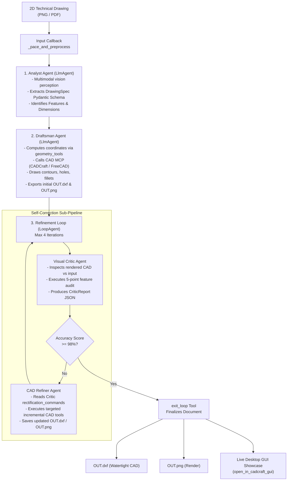

# SketchCAD — Complete Project Architecture & Operational Context

> **Target Audience:** Developers, Collaborators, and Autonomous AI Agents (Zed ACP / Antigravity).  
> **Repository Roots:**  
> - Local: `/home/udhayan/Agent/my_agent/`  
> - Remote DGX: `/home/forge_labs/workspace/udhayan/Ideathon_Sprint/` (Core package at `my_agent/`)  
> **Framework:** Google Agent Development Kit (ADK) & DeciCAD Multi-Agent Architecture  
> **Primary Runtime:** Python 3.10+ (Tested on Python 3.12 / 3.14)  
> **LLM Engine:** Qwen 3.8 27B (vLLM inference on DGX with OpenAI-compatible API)  

---

## 1. Executive Project Mission

**SketchCAD** is an autonomous perception-to-CAD engineering system. Its goal is to take a raw 2D technical drawing (raster image PNG/JPEG or vector PDF) and convert it into a **watertight, production-grade 2D CAD drawing** (DXF and FreeCAD `.FCStd`) with $\ge 98\%$ geometric accuracy.

Traditional approaches that prompt LLMs to write raw OpenSCAD, CadQuery, or FreeCAD scripts fail because:
1. LLMs hallucinate continuous geometry coordinates and struggle with trigonometry for tangent arcs, fillets, and intersection points.
2. Unconstrained visual generation creates open loops, overlapping vertices, and non-watertight contours.
3. Once an error occurs, standard generative pipelines have no feedback loop to inspect their own CAD output and self-correct.

SketchCAD solves this using the **DeciCAD** methodology (*Harness-Grounded Learning of Action Policies for CAD Agents*):
- It separates **semantic perception** (understanding dimensions and features) from **geometric computation** (solving exact tangent points, fillet centers, and arc angles via closed-form geometry functions).
- It executes real CAD commands through **Model Context Protocol (MCP)** tool calling against headless or live CAD engines.
- It closes the loop with an automated **Critic & Refiner loop** that renders a screenshot of the generated CAD model, compares it directly against the input drawing, and autonomously applies targeted patches until accuracy target ($\ge 98\%$) is satisfied.

---

## 2. System Architecture & Multi-Agent Flow

SketchCAD uses Google ADK (`SequentialAgent` and `LoopAgent`) to run a 4-agent stateful pipeline:



### Agent Roles & Specifications

| Agent | ADK Type | Input | Available Tools | Output / State Key |
| :--- | :--- | :--- | :--- | :--- |
| **`analyst`** | `LlmAgent` | User image (`png`/`pdf`) | None (pure semantic vision reasoning) | Saves `drawing_spec` (`DrawingSpec` Pydantic model) into session state |
| **`draftsman`** | `LlmAgent` | `session.state["drawing_spec"]` | CAD MCP tools (`line`, `arc`, `circle`, `fillet`, etc.), 14 `geometry_tools`, `open_in_cadcraft_gui` | Initial CAD document, `OUT.dxf`, screenshot `OUT.png` |
| **`critic`** | `LlmAgent` (Loop) | Input drawing + `OUT.png` | `exit_loop`, `open_in_cadcraft_gui` | Produces `critic_report` (`CriticReport` schema) with numerical accuracy score |
| **`refiner`** | `LlmAgent` (Loop) | `session.state["critic_report"]` | CAD MCP tools, 14 `geometry_tools`, `open_in_cadcraft_gui` | Updates active CAD document, saves new `OUT.dxf` and `OUT.png` |

---

## 3. Directory Layout & Key Modules

Understanding the exact location of each file is critical to prevent import and path errors:

```text
Ideathon_Sprint/                     <-- DGX Workspace Root
├── my_agent/                        <-- Python Application Package Root
│   ├── sketchcad_agent/             <-- Core Agent Logic
│   │   ├── __init__.py              <-- Exposes root_agent, analyst, draftsman, refinement_loop
│   │   ├── agent.py                 <-- ADK pipeline definition, prompts, schemas, LiteLLM wrapper
│   │   ├── geometry_tools.py        <-- 14 analytical geometry solvers (fillets, tangents, intersections)
│   │   ├── cadcraft_examples.py     <-- In-context few-shot CADCraft exemplars
│   │   └── cadcraft_runner.py       <-- Standalone CLI CADCraft runner utility
│   ├── harness/                     <-- Dataset Synthesis & Evaluation Harness
│   │   ├── dataset_generator.py     <-- Parametric CAD drawing generator for 5 mechanical shape classes
│   │   ├── generate_dataset.py      <-- Batch CLI generator script
│   │   ├── evaluator.py             <-- B-rep geometric validator (watertightness, tangency, MAE)
│   │   └── image_to_cad_harness.py  <-- End-to-end benchmark harness (image -> DXF -> eval)
│   ├── training/                    <-- VLM Fine-Tuning Pipeline
│   │   ├── prepare_vlm_data.py      <-- Formatter for Qwen-VL, OpenAI, and Gemini datasets
│   │   └── train_lora.py            <-- PEFT LoRA training script (rank=16, alpha=32)
│   ├── scripts/                     <-- Automation & Utility Scripts
│   │   ├── run_agent_task.py        <-- Non-interactive CLI agent runner
│   │   ├── start_bridge.py          <-- FreeCAD XML-RPC socket bridge launcher
│   │   └── ingest_dxf_dataset.py    <-- Dataset ingestion utility
│   ├── tests/                       <-- Pytest Unit & Integration Tests (44+ tests)
│   │   ├── test_schema.py           <-- Pydantic schema validation tests
│   │   ├── test_geometry_tools.py   <-- Verification of all 14 analytical geometry routines
│   │   ├── test_five_shapes.py      <-- Tests for 5 canonical mechanical parts
│   │   ├── test_dataset_harness.py  <-- Tests for evaluation metrics and watertightness
│   │   └── test_agent_optimizations.py <-- Tests for Qwen vLLM adaptations and timeout configs
│   ├── .env                         <-- Environment variables (endpoints, models, backend)
│   ├── .env.example                 <-- Example template for environment configuration
│   ├── requirements.txt             <-- Python dependencies
│   └── run.sh                       <-- Primary launcher script (bridge check + ADK web UI)
├── pyproject.toml                   <-- Project metadata & tool configurations (ruff, pytest, pyright)
└── pyrightconfig.json               <-- LSP configuration bound to my_agent/.venv
```

---

## 4. How the Project is Configured to Run (Model & Endpoints)

### DGX Model Setup (vLLM)
- The model runs on the DGX GPU cluster via **vLLM** on port `8100` (`http://localhost:8100/v1` or `http://192.168.55.98:8100/v1`).
- Served Model Name: `qwen3.8-flash-next` (or `qwen3.8-27b`).
- It uses standard OpenAI-compatible completions and streaming SSE.

### Critical Model Optimization: Thinking Token Suppression
Qwen 3.8 has a native reasoning/thinking engine. In raw conversational mode, it outputs thousands of internal thinking tokens before emitting CAD commands, which causes timeouts and breaks tool parsers.
In [sketchcad_agent/agent.py](file:///home/udhayan/Agent/my_agent/sketchcad_agent/agent.py), this is explicitly handled:
```python
extra_body = {}
if 'qwen' in MODEL.lower():
    extra_body['chat_template_kwargs'] = {'enable_thinking': False}
```
This forces the model to respond directly with structured tool calls or valid JSON schemas.

### CAD Backends (`CAD_BACKEND` in `.env`)
1. **`cadcraft` (Default & Recommended)**:
   - Uses `cadcraft-cli mcp` via standard I/O (stdio).
   - Generates clean 2D vector CAD entities (`line`, `arc`, `circle`, `dimlinear`, `dimradius`).
   - Supports live GUI display via `open_in_cadcraft_gui("OUT.dxf")`.
2. **`freecad`**:
   - Uses `freecad-robust-mcp` via XML-RPC bridge on `localhost:9875`.
   - Generates full 3D/2D constraint sketches in FreeCAD.

---

## 5. Common Code Errors & How to Avoid Them

When working on or modifying this codebase, the model and developers must adhere to the following rules to prevent regressions:

### 1. Workspace Root & Nested Import Paths
- **The Problem:** The repository root is `Ideathon_Sprint`, but the Python package root is `my_agent/`. Running scripts from the repository root without `my_agent` in `sys.path` or `PYTHONPATH` causes `ModuleNotFoundError: No module named 'sketchcad_agent'`.
- **The Fix:**
  - Always run commands with `PYTHONPATH=my_agent` or from within the `my_agent/` directory:
    ```bash
    cd /home/forge_labs/workspace/udhayan/Ideathon_Sprint/my_agent
    source .venv/bin/activate
    ```
  - In [sketchcad_agent/agent.py](file:///home/udhayan/Agent/my_agent/sketchcad_agent/agent.py), absolute and package imports must use `from sketchcad_agent.geometry_tools import ...` or `from sketchcad_agent.cadcraft_examples import ...`.

### 2. vLLM Tool Choice & Auto-Call Parsing
- **The Problem:** Open-weight models running on vLLM can fail when LiteLLM sends `tool_choice: "auto"` if the server doesn't support the exact tool parser.
- **The Fix:** [sketchcad_agent/agent.py](file:///home/udhayan/Agent/my_agent/sketchcad_agent/agent.py) implements `QwenLiteLlm` which patches LiteLLM completions to prevent invalid `tool_choice` states and ensures clean fallback to structured output schema parsing.

### 3. Pydantic Schema Mismatches (`DrawingSpec` & `CriticReport`)
- **The Problem:** The Analyst and Critic agents output JSON that is validated against Pydantic models. If the prompt asks for fields not in the schema (e.g. nested lists formatted incorrectly), Pydantic raises a `ValidationError`.
- **The Fix:**
  - `DrawingSpec` schema in `agent.py`: Requires `entities: list[Entity]`, `relations: list[Relation]`, `overall_dimensions: OverallDimensions`, and `features: list[Feature]`.
  - `CriticReport` schema: Requires `accuracy_score: float` (0.0 to 100.0), `is_accurate: bool`, `errors: list[CriticError]`, and `rectification_commands: list[str]`.
  - Never alter these models without updating both the system prompts in `agent.py` and the unit tests in [tests/test_schema.py](file:///home/udhayan/Agent/my_agent/tests/test_schema.py).

### 4. Direct Manual Trimming vs Analytical Geometry
- **The Problem:** LLMs frequently attempt to compute fillets or tangent arcs by creating full circles and guessing where they intersect, leading to open contours and CAD solver failures.
- **The Fix:** The Draftsman and Refiner agents **must always** call the analytical geometry routines in [sketchcad_agent/geometry_tools.py](file:///home/udhayan/Agent/my_agent/sketchcad_agent/geometry_tools.py):
  - `fillet_two_lines(p1, p_corner, p2, radius)`: Solves exact start, end, and center coordinates for rounded corners.
  - `tangent_lines_two_circles(c1, r1, c2, r2)`: Computes exact outer/inner tangent lines between two pulleys/bosses.
  - `circle_line_intersections(center, radius, p1, p2)`: Finds exact intersection points for cutouts and keyways.
  - `arc_angles(center, p_start, p_end)`: Calculates start and end angles in degrees for CAD `arc` commands.

### 5. Watertightness & Tolerance Standards
- **Tolerance threshold:** $\le 0.05$ mm gap between consecutive endpoints.
- **Tangency threshold:** $\le 0.1^\circ$ angular mismatch at transition points.
- Any generated CAD loop must start and end at the exact same coordinate $(x_0, y_0)$. If the contour has a gap $> 0.05$ mm, [harness/evaluator.py](file:///home/udhayan/Agent/my_agent/harness/evaluator.py) marks it as **non-watertight**, scoring it below $65\%$.

---

## 6. How the System Operates End-to-End

### Step 1: Perception (Analyst)
1. User provides a drawing image (e.g., `plug_gauge_harness.png`).
2. The `Analyst` vision model scans the drawing in 3 passes:
   - Identifies all numerical dimension callouts (e.g., `Ø30`, `R55`, `12.5`, `60°`).
   - Normalizes coordinates into millimeters, placing $(0,0)$ at the bottom-left datum.
   - Outputs a validated `DrawingSpec` JSON and stores it in session state.

### Step 2: Initial Construction (Draftsman)
1. The `Draftsman` retrieves `{drawing_spec}`.
2. It calls geometry calculation tools to compute exact tangent lines, arc centers, and fillets.
3. It issues MCP commands to CADCraft (`line`, `arc`, `circle`) or FreeCAD.
4. It calls `save(path="OUT.dxf")` and `render(fit=True, path="OUT.png")`.
5. It calls `open_in_cadcraft_gui(file_path="OUT.dxf")` to display the CAD drawing live in the desktop viewer.

### Step 3: Self-Correction Loop (Critic + Refiner)
1. The `Critic` inspects `OUT.png` side-by-side with the original drawing against 5 mandatory checks:
   - **Check A**: Base contour and lower fillets.
   - **Check B**: Left profile and reverse bulge arc.
   - **Check C**: Main outer head arc.
   - **Check D**: Right protrusion / ear at specified angle.
   - **Check E**: Inner features (central bore hole + keyway slot).
2. If any mandatory feature is missing or misaligned:
   - Score is capped at $< 65\%$.
   - `is_accurate` is set to `False`.
   - Structured rectification commands (exact CAD tool calls) are generated.
3. The `Refiner` executes the commands on the active CAD drawing without erasing previous work (state grounding).
4. The loop repeats (up to 4 times) until the score reaches $\ge 98.0\%$, at which point the Critic calls `exit_loop`.

---

## 7. Operational Runbook & Verification Commands

### Activating the Environment
```bash
# On DGX:
cd /home/forge_labs/workspace/udhayan/Ideathon_Sprint/my_agent
source .venv/bin/activate

# On Local Machine:
cd /home/udhayan/Agent/my_agent
source /home/udhayan/Agent/.venv/bin/activate
```

### Running Unit & Regression Tests
```bash
pytest -v tests/
```
*Expected: 37+ passed, 0 failed.*

### Running the End-to-End Image-to-CAD Benchmark
```bash
python harness/image_to_cad_harness.py
```
*Expected: Reconstructs [plug_gauge_harness.png](file:///home/udhayan/Agent/my_agent/harness/plug_gauge_harness.png) to [plug_gauge_harness.dxf](file:///home/udhayan/Agent/my_agent/harness/plug_gauge_harness.dxf) with 100.0% geometric accuracy.*

### Running the ADK Interactive Web Interface
```bash
# Using the pre-flight launcher:
./run.sh

# Or directly via ADK:
adk web --host 0.0.0.0 --port 7020
```
Open browser at `http://localhost:7020` (or `http://192.168.55.98:7020` over network/port-forwarding), select `sketchcad_agent`, upload a technical drawing, and submit.
