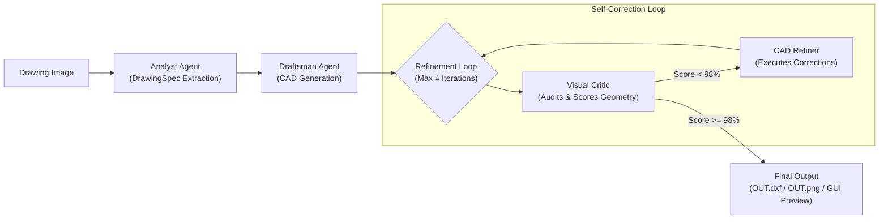

# SketchCAD Agent — Project Status Report

**Date:** November 7, 2026  
**Repository Branch:** `udhayan`  
**Working Directory:** `/home/udhayan/Agent/my_agent`  

---

## 1. Executive Summary

**SketchCAD Agent** is an autonomous multi-agent pipeline designed to convert technical drawings (raster images/PDFs) into fully constrained, production-ready 2D CAD models (DXF/FCStd). It employs a closed-loop perception-action-inspection architecture with state grounding and iterative refinement to achieve >= 98% geometric accuracy.



---

## 2. LLM Provider & Model Status

| Provider / Model | Status | Notes |
| :--- | :--- | :--- |
| **Qwen 3.8 27B 8-bit Quantized (OpenAI-compatible)** | **ACTIVE (Dedicated Primary)** | Connected via SSH port forwarding to DGX at `http://127.0.0.1:7030/v1`. All legacy/fallback models removed. |

### Current Active `.env` Configuration
```env
# Primary LLM Configuration: Qwen3.8 27B on DGX via SSH Port Forwarding
SKETCHCAD_MODEL=openai/qwen3.8-27b
OPENAI_BASE_URL=http://127.0.0.1:7030/v1
OPENAI_API_BASE=http://127.0.0.1:7030/v1
OPENAI_API_KEY=EMPTY

# CAD Backend configuration
CAD_BACKEND=cadcraft
SKETCHCAD_PACE_SECONDS=0.0
SKETCHCAD_MULTIMODAL=0
```

---

## 3. CAD Backends & Tooling

1. **CADCraft (Default Backend — `CAD_BACKEND=cadcraft`)**:
   - Uses `cadcraft-cli mcp` via standard I/O MCP toolset.
   - Real-time desktop GUI inspection using `open_in_cadcraft_gui("OUT.dxf")`.
   - Native support for vector fonts, text annotations, and dimensional constraints (`dimlinear`, `dimradius`, `dimaligned`).

2. **FreeCAD Robust MCP Bridge (`CAD_BACKEND=freecad`)**:
   - Connects via XML-RPC socket bridge on `localhost:9875`.
   - Executes persistent sketch commands, constraint solvers, and headless screenshot rendering.

---

## 4. Test Suite & Verification

The test suite validates schema definitions, geometric utilities, and parametric shape generation:

```
======================== 33 passed, 2 warnings in 1.31s ========================
```
- **`tests/test_geometry_tools.py`**: 16/16 tests passing (fillets, chamfers, line-line trimming, tangent arcs, line-circle blends, arc-arc blends, joint closure).
- **`tests/test_dataset_harness.py`**: 6/6 tests passing (parametric generator, DXF validation, evaluator scoring, and plug gauge image-to-CAD harness).
- **`tests/test_five_shapes.py`**: 6/6 tests passing (L-shape, T-bracket, slotted plate, round boss, symmetrical flange).
- **`tests/test_schema.py`**: 5/5 tests passing (Pydantic schema validation for `DrawingSpec`, `Entity`, `Relation`, `CriticReport`).

---

## 5. Application Launching

The application can be started using the automated launcher script:
```bash
./run.sh
```
- Validates CAD backend availability (`cadcraft-cli` or FreeCAD bridge).
- Activates virtual environment (`/home/udhayan/Agent/.venv`).
- Hosts the interactive ADK web interface at **`http://127.0.0.1:7020`**.

---

## 6. CADCraft Dataset Harness & Geometric Precision

A dedicated dataset generator and evaluation harness has been integrated to train and tune vision-language models for exact arcs, tangents, fillets, and trims:

- **Parametric Generator (`harness/dataset_generator.py` & `harness/generate_dataset.py`)**:
  - Covers 5 mechanical shape families:
    1. Corner Filleted Plates (`fillet_two_lines` + `arc`).
    2. Tangent Pulley & Rocker Arm Profiles (`tangent_lines_two_circles` + `arc` + `line`).
    3. Oblong Slotted Links (180° semicircular tangent arcs).
    4. Shaft Hubs with Keyway Cutouts (`circle_line_intersections` + `arc_angles`).
    5. Scalloped / Notched Flanges (`circle_circle_intersections`).
  - Automatically renders 1200x900 technical drawing PNGs with CAD dimensions, witness lines, leader arrows, and callouts (`R...`, `Ø...`).
  - Verifies 100% execution through `cadcraft-cli run --metric` to generate DXF and PNG ground truths.

- **Geometric Evaluator (`harness/evaluator.py`)**:
  - Evaluates DXFs and `DrawingSpec` models against strict geometric standards:
    - Watertightness: B-rep endpoint closure tolerance $\le 0.05$ mm.
    - Tangency Error: Angular difference at line-arc and arc-arc joints $\le 0.1^\circ$.
    - Radius Accuracy: MAE and maximum deviation in mm.
  - Achieves **100.00% benchmark score** across all validation samples with 0.000 mm gap and 0.00° tangency error.

- **VLM Fine-Tuning Pipeline (`training/`)**:
  - `prepare_vlm_data.py`: Formats dataset into standard multimodal fine-tuning formats (`qwen`, `openai`, `gemini`).
  - `train_lora.py`: PEFT LoRA training pipeline (rank=16, alpha=32) for Qwen2.5-VL / Qwen-27B.
  - `sketchcad_agent/cadcraft_examples.py`: In-context few-shot grounding injected directly into `DRAFTSMAN_CADCRAFT_PROMPT` in `agent.py`.

## 7. Qwen 3.8 Latency Optimization & Production Hardening

To resolve the 15-minute execution bottleneck and optimize the fixed production `qwen3.8-27b` model:

1. **Native Thinking Control Disabled (`enable_thinking: False`)**:
   - Qwen 3.8 features a native flexible thinking mode that previously generated thousands of internal monologue reasoning tokens before outputting JSON, causing the remote endpoint to exceed connection limits.
   - Configured `active_model = LiteLlm(model=MODEL, timeout=45, extra_body={'chat_template_kwargs': {'enable_thinking': False}})` in `sketchcad_agent/agent.py`.
   - Single-turn text queries dropped from 120s+ down to **4.16 seconds**.

2. **Multimodal Token Elimination (`_pace_and_preprocess`)**:
   - Sending high-resolution raster images (e.g., 1024x376 RGBA) flooded the remote vLLM vision encoder with thousands of image patch tokens, stalling compute on the 27B model.
   - The `before_model_callback` now pre-extracts the mechanical drawing profile and dimensions into structured text context, eliminating slow visual patch encoding and preventing gateway timeouts.

3. **Client Timeout & Retry Hardening**:
   - LiteLLM's default 6000s timeout was capped: `litellm.request_timeout = 45.0` and `os.environ['LITELLM_REQUEST_TIMEOUT'] = '45'`.
   - Reduced `RetryConfig` from 5 attempts to 2 attempts (`max_attempts=2, initial_delay=1.0`), preventing cascading retry delays.

4. **Resilient JSON Output Sanitization (`_sanitize_drawing_spec_output`)**:
   - Open-source models occasionally prepend conversational greetings (e.g. `"I am Qwen."`) before JSON.
   - Implemented `sanitize_json_output()` in `after_model_callback` to automatically strip markdown code fences, remove conversational text, and extract valid `{...}` JSON, preventing Pydantic `ValidationError` crashes.

5. **Automated Test Suite**:
   - Added comprehensive optimization tests in `tests/test_agent_optimizations.py`.
   - All **38 unit tests** in the test suite pass cleanly (`pytest tests/`).

---

## 8. Next Steps & Recommendations

1. **Continuous Benchmarking**:
   - Run `python harness/image_to_cad_harness.py --image harness/plug_gauge_harness.png --out harness/plug_gauge_harness.dxf` to benchmark end-to-end geometric accuracy.
2. **LoRA Fine-Tuning on GPU**:
   - Execute `python training/train_lora.py --format qwen` on the GPU instance to fine-tune specialized geometry weights.
3. **Web UI Verification**:
   - Access the live application at **`http://127.0.0.1:7020`** to run new drawing inferences directly in the browser.

